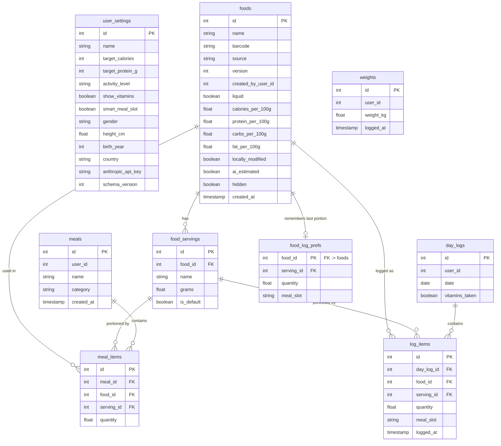

# Database Schema

SQLite, on-device (`expo-sqlite`). Defined in [`app/src/db/schema.ts`](../app/src/db/schema.ts) — that file is the source of truth; this doc is a human-readable mirror of it. Current schema version: **v9**.

There is a single implicit user (`user_id` hardcoded to `1` throughout) — `user_settings` holds that user's profile and targets instead of a `users` table.

## ER Diagram

---

## Table Descriptions

### user_settings

Single-row table (`id = 1`) — this app has one implicit local user, no `users` table or auth.

| Column             | Type    | Notes                                                          |
|--------------------|---------|-----------------------------------------------------------------|
| id                 | int     | PK, always `1`                                                  |
| name               | text    | nullable                                                         |
| target_calories    | int     | daily calorie goal, default 2000                                |
| target_protein_g   | int     | daily protein goal in grams, default 150                        |
| activity_level     | text    | `SEDENTARY` \| `LIGHTLY_ACTIVE` \| `MODERATELY_ACTIVE` \| `VERY_ACTIVE` \| `EXTREMELY_ACTIVE` |
| show_vitamins      | boolean | shows a daily vitamins-taken toggle on Today when on            |
| smart_meal_slot    | boolean | auto-selects meal slot from logging history, default on         |
| gender             | text    | `MALE` \| `FEMALE` \| `OTHER`, nullable — used for Mifflin-St Jeor TDEE |
| height_cm          | float   | nullable — used for TDEE                                        |
| birth_year         | int     | nullable — used for TDEE                                        |
| country            | text    | nullable — default country for AI meal estimation                |
| anthropic_api_key  | text    | nullable — user-supplied key for AI meal estimation              |
| schema_version     | int     | tracks which migrations have run (see schema.ts)                 |

---

### foods

The canonical food item. All nutrition values are stored **per 100g**.

| Column             | Type      | Notes                                                        |
|--------------------|-----------|--------------------------------------------------------------|
| id                 | int       | PK                                                           |
| name               | text      |                                                              |
| barcode            | text      | nullable, indexed                                            |
| source             | enum      | `USER`, `VERIFIED`, `OPENFOODFACTS`                          |
| version            | int       | increments when a food is edited (creates new row)           |
| created_by_user_id | int       | nullable                                                      |
| liquid             | boolean   | true for drinks; UI shows "per 100ml" instead of "per 100g"  |
| calories_per_100g  | float     |                                                              |
| protein_per_100g   | float     |                                                              |
| carbs_per_100g     | float     |                                                              |
| fat_per_100g       | float     |                                                              |
| locally_modified   | boolean   | true once a cached OPENFOODFACTS/VERIFIED food's macros are edited |
| ai_estimated       | boolean   | true if created via the AI meal estimation flow               |
| hidden             | boolean   | soft-deleted; excluded from search and recent foods          |
| created_at         | timestamp |                                                              |

**Foods are immutable.** Editing a food creates a new row with an incremented version. Old log entries reference their original food row and will never silently change calorie values.

**Foods are never hard-deleted.** Hiding a food (`hidden = 1`) only removes it from search and recent foods — `log_items` and `meal_items` that reference it are unaffected.

---

### food_servings

Custom serving units for a food (e.g. "1 slice = 30g", "1 egg = 55g").

| Column     | Type    | Notes                              |
|------------|---------|-------------------------------------|
| id         | int     | PK                                  |
| food_id    | int     | FK → foods                          |
| name       | text    | e.g. "slice", "piece", "tbsp"       |
| grams      | float   | how many grams this serving equals  |
| is_default | boolean | shown first in the portion picker   |

---

### meals

A saved, reusable meal (e.g. "My usual breakfast").

| Column     | Type      | Notes                                    |
|------------|-----------|--------------------------------------------|
| id         | int       | PK                                        |
| user_id    | int       | hardcoded `1`                             |
| name       | text      |                                            |
| category   | enum      | `BREAKFAST`, `LUNCH`, `DINNER`, `SNACK`, nullable |
| created_at | timestamp |                                            |

---

### meal_items

The foods that make up a saved meal, with their quantities.

| Column     | Type  | Notes                                             |
|------------|-------|-----------------------------------------------------|
| id         | int   | PK                                                |
| meal_id    | int   | FK → meals, cascades on delete                    |
| food_id    | int   | FK → foods                                        |
| serving_id | int   | FK → food_servings, nullable (falls back to 100g) |
| quantity   | float | number of servings                                |

**Planned evolution (Phase 5 — Nested Meal Collections):** Add a nullable `sub_meal_id` column (FK → meals) so a meal item can reference either a food or another meal — never both. This enables composable collections like "Usual breakfast" containing a "2 scrambled eggs" sub-meal plus individual items.

Constraints to enforce when implemented:

- Exactly one of `food_id` or `sub_meal_id` must be non-null (check constraint)
- Cycle detection required — a meal cannot reference itself directly or transitively; validate the full ancestor chain on insert
- Macro calculation becomes recursive: sum the resolved macros of all nested items depth-first

---

### day_logs

One row per user per day. The parent record for all log items on that day.

| Column         | Type    | Notes                     |
|----------------|---------|----------------------------|
| id             | int     | PK                        |
| user_id        | int     | hardcoded `1`              |
| date           | date    | unique per user            |
| vitamins_taken | boolean | daily vitamins checkbox    |

---

### log_items

A single food entry in a day's log.

| Column      | Type      | Notes                                             |
|-------------|-----------|-----------------------------------------------------|
| id          | int       | PK                                                |
| day_log_id  | int       | FK → day_logs                                     |
| food_id     | int       | FK → foods                                        |
| serving_id  | int       | FK → food_servings, nullable (falls back to 100g) |
| quantity    | float     | number of servings                                |
| meal_slot   | enum      | `BREAKFAST`, `LUNCH`, `DINNER`, `SNACK`           |
| logged_at   | timestamp |                                                   |

**Macro calculation:** `(food.calories_per_100g / 100) * serving.grams * quantity`

---

### weights

Body weight log entries.

| Column    | Type      | Notes         |
|-----------|-----------|----------------|
| id        | int       | PK             |
| user_id   | int       | hardcoded `1`  |
| weight_kg | float     |                |
| logged_at | timestamp |                |

---

### food_log_prefs

Remembers the last serving, quantity, and meal slot used for each food, so PortionScreen can pre-fill them next time. One row per food (upserted on every log).

| Column     | Type  | Notes                                              |
|------------|-------|------------------------------------------------------|
| food_id    | int   | PK, FK → foods                                     |
| serving_id | int   | FK → food_servings, nullable                       |
| quantity   | float |                                                     |
| meal_slot  | enum  | `BREAKFAST`, `LUNCH`, `DINNER`, `SNACK`            |
